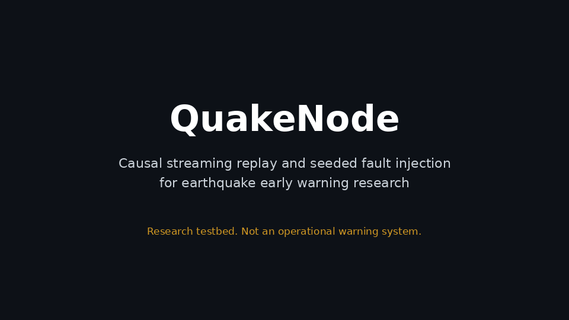
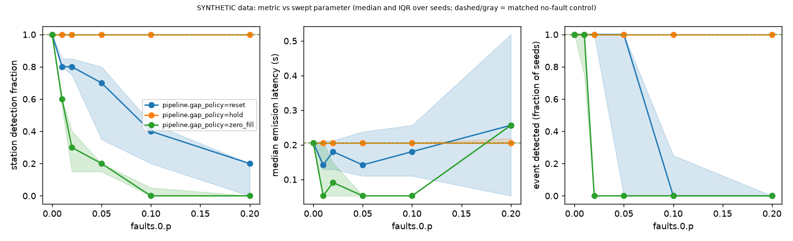

# QuakeNode

[](https://github.com/vincentvega011/quakenode/actions/workflows/ci.yml)
[](LICENSE)
[](pyproject.toml)

**Test earthquake early warning detectors the way a live system sees data.**

QuakeNode is an open-source Python testbed for evaluating earthquake early warning (EEW) detectors as **causal streaming systems**. Describe a multi-station experiment in YAML, and QuakeNode replays station data on a logical clock, injects seeded network faults, runs streaming detectors and a fusion rule, and writes metrics, plots, an event log and a reproducibility manifest.

> **Research testbed, not an operational warning system.** Do not use QuakeNode to issue, suppress or inform real alerts or any safety decision. The network scenarios it generates are **SYNTHETIC**: they exercise the software and are not a seismological model.



## Features

- **Causal by construction.** A detector only sees packets whose simulated arrival time has passed. Tests alter only future packets and assert that everything emitted earlier is identical.
- **Four separate clocks.** Sample, ready, arrival and emission times are never merged, so latency means one precise thing.
- **Seeded fault injection.** Fixed delay, jitter (uniform, exponential), packet loss (Bernoulli, Gilbert-Elliott burst), duplicates, reordering, station outages, clock offsets and missing samples. Faults compose in a declared order and every application is logged.
- **Explicit gap handling.** What happens after a gap is a configurable policy (`reset`, `hold`, `zero_fill`), not a hidden default. Nothing is ever interpolated.
- **Paired experiments.** A sweep compares every fault setting against a matched no-fault control, seed by seed. `quakenode compare` pairs two settings (two detectors, two policies, two input kinds) per station.
- **Reproducible runs.** Every run writes a new directory with a manifest (config snapshot, seeds, git commit, versions), an event log, metrics, a report and plots.
- **Pluggable.** A small detector protocol and registry, a k-of-n fusion rule, and a strict YAML schema that rejects unknown keys.
- **Optional real-event replay.** Replay recorded INSTANCE events through the same chain (your own copy of the data, nothing shipped).

## Why this exists

A detector that looks good on a pre-processed, whole-window benchmark file has seen data a live system would not have had yet, and a live system also sees late, lost and reordered packets. QuakeNode is a small, controlled and repeatable way to ask what changes when those conditions are applied.



*SYNTHETIC data. Metric versus packet-loss probability for the 5-station example under the three gap policies (median and IQR over 8 seeds; dashed = matched no-fault control). Produced by `quakenode sweep examples/synthetic_network/sweep.yaml`.*

How to read it: under the default `reset` policy a lost packet is a gap, the detector resets and is blind until its 4 s LTA window refills, so even 1 to 2% loss removes many detections. With `hold` the same loss costs almost nothing, so the large sensitivity under `reset` comes from the reset rule plus the window length, **not from loss itself**. `zero_fill` is worse than both here because inserted zeros against the scenario baseline trigger the detector. Details and caveats: [`docs/gap_policies.md`](docs/gap_policies.md).

## Quickstart

Requires Python 3.10 or newer. QuakeNode is not on PyPI yet, so install from a clone:

```bash
git clone https://github.com/vincentvega011/quakenode.git
cd quakenode
python3 -m venv .venv && source .venv/bin/activate
pip install ".[plots]"            # pyyaml is the only runtime dependency; matplotlib (plots) is optional

quakenode demo                    # writes ./quakenode_demo/{config.yaml,sweep.yaml} and runs the SYNTHETIC example
quakenode sweep quakenode_demo/sweep.yaml     # packet loss x three gap policies, paired with controls
quakenode run quakenode_demo/config.yaml --set pipeline.gap_policy=hold
quakenode compare quakenode_demo/config.yaml --a pipeline.gap_policy=reset --b pipeline.gap_policy=hold
```

`quakenode demo` needs no repository files (the example configs are packaged). Every command prints the research-testbed banner and writes a **new** directory, never overwriting an old one.

| command | what it does |
|---|---|
| `quakenode demo` | write the SYNTHETIC example configs and run them |
| `quakenode run CONFIG` | run one scenario over all seeds |
| `quakenode sweep CONFIG` | sweep one or two parameters, each point paired with a matched no-fault control |
| `quakenode compare CONFIG --a ... --b ...` | run two settings on the same stations and seeds and pair them per station |
| `quakenode validate CONFIG` | validate a config against the strict schema |
| `quakenode report RUN_DIR` | regenerate `report.md` and plots for a saved run or sweep directory |
| `quakenode version` | print the version |

`--set key=value` (repeatable, dotted paths) overrides any config value and is validated by the same schema; applied overrides are recorded in the manifest. A detector switch needs that detector's own parameters, for example `--set detector.name=recursive_sta_lta --set 'detector.params={sta_s: 0.5, lta_s: 4.0}'`.

## A config at a glance

```yaml
# SYNTHETIC 5-station demo (trimmed from examples/synthetic_network/config.yaml)
schema_version: 1
name: synthetic_network_demo
seeds: [1, 2, 3, 4, 5, 6, 7, 8]

scenario:
  type: synthetic_network
  duration_s: 45
  sample_rate_hz: 40
  packet_len_samples: 20          # 0.5 s packets
  stations:
    - {id: S1, x_km: 0,  y_km: 0}
    - {id: S2, x_km: 60, y_km: 10}
    # ...
  event: {origin_time_s: 15.0, x_km: 25, y_km: 30, depth_km: 10, amplitude: 60}

detector:
  name: sta_lta_rms               # or recursive_sta_lta
  params: {sta_s: 0.5, lta_s: 4.0, threshold: 3.0}

pipeline:
  order_policy: buffer            # reject | buffer | drop_late
  gap_policy: reset               # reset | hold | zero_fill

faults:                           # applied in this order
  - {type: fixed_delay, delay_s: 0.3, targets: all}
  - {type: jitter, distribution: exponential, mean_s: 0.1, targets: all}
  - {type: packet_loss, model: bernoulli, p: 0.1, targets: all}

fusion: {k: 3, window_s: 10, update_window_s: 5, window_clock: emission}
```

A run directory contains `manifest.json`, `events.jsonl`, `metrics.json`, `metrics.csv`, `report.md` and `plots/`. See [`examples/synthetic_network/README.md`](examples/synthetic_network/README.md) for a walk-through.

## How it works

```
YAML config -> SYNTHETIC traces -> packets (sample / ready / arrival times) -> seeded faults
   -> replay engine (a packet is visible only after its arrival time) -> streaming detectors
   -> k-of-n fusion -> metrics, events.jsonl, report, manifest
```

| module | purpose |
|---|---|
| `quakenode.config` | strict YAML validation (unknown keys rejected, ranges checked, errors name file and key) |
| `quakenode.scenario` | SYNTHETIC N-station network and event generator, plus the scenario loader shared with real events |
| `quakenode.faults` | the fault library; each application writes a `FaultRecord` |
| `quakenode.replay` | `Packet`, logical clock, replay engine and a receiver that only holds delivered packets |
| `quakenode.streaming` | detector protocol and registry, built-in `sta_lta_rms` and `recursive_sta_lta`, pipeline with out-of-order (`reject`, `drop_late`, `buffer`) and gap policies |
| `quakenode.fusion` | k-of-n event candidates on the emission (or arrival) clock, with a decision log |
| `quakenode.evaluation` | latencies, detection rates, false triggers, completeness, association latency, seed-paired fault sensitivity |
| `quakenode.manifest` | run manifest: config snapshot, seeds, git commit, versions, dataset records |
| `quakenode.data` | optional INSTANCE and miniSEED adapters (extra `data`); not needed for the synthetic workflow |

Design notes and the four clocks: [`docs/architecture.md`](docs/architecture.md). Metric definitions: [`docs/metrics.md`](docs/metrics.md).

## Replay a real recorded event (optional)

With the extra `data` and your own copy of the INSTANCE v3 sample (CC BY 4.0, INGV), `source: instance_event` replays one recorded event through the same chain. Input `release_hdf5` is the INSTANCE release product (full-window processed, **not causal input**); input `mseed` is raw INGV miniSEED fetched by `scripts/fetch_dev_events.py`. The per-station reference is the catalog P sample with its stated uncertainty, and every output is labeled with its input kind and data source. Steps and configs: [`examples/instance_event/`](examples/instance_event/). What was run on 3 development events is written up in [`docs/real_event_demo.md`](docs/real_event_demo.md): **tool demonstrations, not performance evidence.** The repository contains no waveform data.

## Extending QuakeNode

**Add a detector.** Implement the streaming detector protocol (`quakenode.streaming.StreamDetector`): attributes `name`, `version`, `warmup_s`, a `warming_up` flag, `reset()` (called after a gap) and `process(packet, processed_at_s) -> list[Detection]`, which consumes one in-order packet. Then register it:

```python
from quakenode.streaming import DetectorSpec, Param, register_detector

register_detector(
    DetectorSpec(
        "my_detector",
        {"threshold": Param(float, 3.0, minimum=0.0, exclusive_min=True)},
        lambda params, processing_delay_s: lambda station, channel, rate_hz: MyDetector(params["threshold"], rate_hz),
    )
)
```

and use `detector: {name: my_detector, params: {threshold: 4.0}}` in a config. Two complete examples are in `src/quakenode/streaming/detectors.py`.

**Add a fault.** A fault is a frozen dataclass with a `type` and `apply(packets, seed) -> (packets, FaultRecord)`. It may change packet metadata, presence or length but never sample values, and draws randomness only from `quakenode.faults.Stream(seed)`. Add its parameter spec to `quakenode.config.FAULT_SPECS`, a branch in `quakenode.experiment.build_fault`, and a pinned-pattern test (see `tests/test_faults.py`).

New to the project? [`docs/good_first_issues.md`](docs/good_first_issues.md) lists small, bounded tasks.

## Status and limitations

- **Alpha research software, version 0.2.0.** The configuration schema and output files may change between minor versions (see [`CHANGELOG.md`](CHANGELOG.md)).
- Scenario data are **SYNTHETIC** unless a real recorded event is replayed, and then only as a tool demonstration. Results say nothing about real earthquakes, real networks, real detector performance or warning times.
- Two built-in detectors (RMS STA/LTA first trigger, recursive STA/LTA) and one fusion rule (k-of-n). No location, magnitude, ground-motion or target-site warning-time estimation.
- Gap handling is a policy with caveats ([`docs/gap_policies.md`](docs/gap_policies.md)); with `reset` and a long LTA window, small loss rates remove many detections. That is a property of the policy and the detector, not of loss itself.
- CI runs ruff, formatting and the test suite on Linux (Python 3.10, 3.11, 3.12), macOS and Windows, plus a CLI smoke test and a wheel build.
- An earlier real-data research thread (released INSTANCE full-window counts versus causally processed raw miniSEED) is paused in favour of the tool. Its documents and scripts stay in the repository ([`docs/instance_access.md`](docs/instance_access.md), [`docs/detrend_check_results.md`](docs/detrend_check_results.md)) and are not needed for the synthetic workflow.

## Related tools

QuakeNode covers a much smaller scope than the tools below. This list uses only what [`docs/prior_art_artifact_check.md`](docs/prior_art_artifact_check.md) recorded (audit date 2026-10-26; documentation and READMEs read, most code not run):

- **SeisComP** (AGPL-3.0): an acquisition, processing and distribution system. Its documentation describes the `scautopick` STA/LTA picker with a `--playback` option and `msrtsimul` for real-time playback of miniSEED. The pages read describe no fault injection. QuakeNode is not a production system; it adds a small pip-installable replay with seeded faults and a manifest for detector experiments.
- **ObsPy** (`obspy.realtime`, LGPL-3.0): `RtTrace` processes periodically appended data packets with causal time-domain operations. It is a processing library, not an evaluation harness. QuakeNode's optional `data` extra uses ObsPy to read miniSEED.
- **SeisBench** (GPL-3.0): dataset loaders (including INSTANCE) and machine-learning pickers applied to waveform windows. The audit found no streaming evaluation mode. Because of its licence QuakeNode never vendors it or imports it from the core package.
- **OpenEEW** (Apache-2.0): an open accelerometer dataset and code. A keyword search of its main repository found no replay or evaluation tooling; other repositories in the organisation were not checked.
- Others recorded in the audit: the EPOS CREW testing centre and published replay studies such as Zuccolo et al. (2021).

We make no novelty claim: what QuakeNode adds is for its own experiments to show.

## Development

```bash
pip install -e ".[dev,data,plots]"
ruff check . && ruff format --check . && pytest
```

See [`CONTRIBUTING.md`](CONTRIBUTING.md) for the rules every change must respect (no future-sample leakage, the four clocks kept apart, determinism, no operational claims).

## Citing

If you use QuakeNode, please cite it using [`CITATION.cff`](CITATION.cff). GitHub shows a "Cite this repository" button.

## License

MIT, code only. Datasets and model weights have their own terms.
