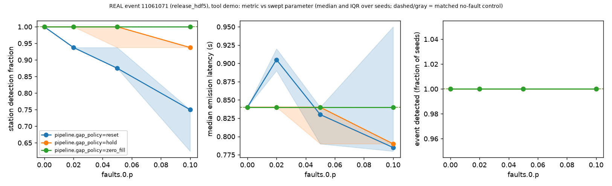
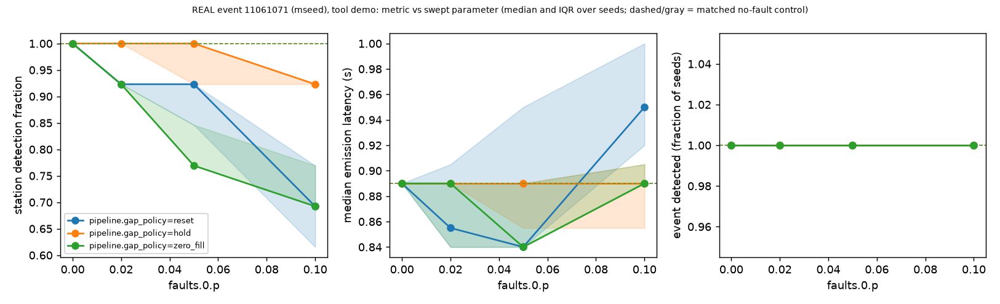
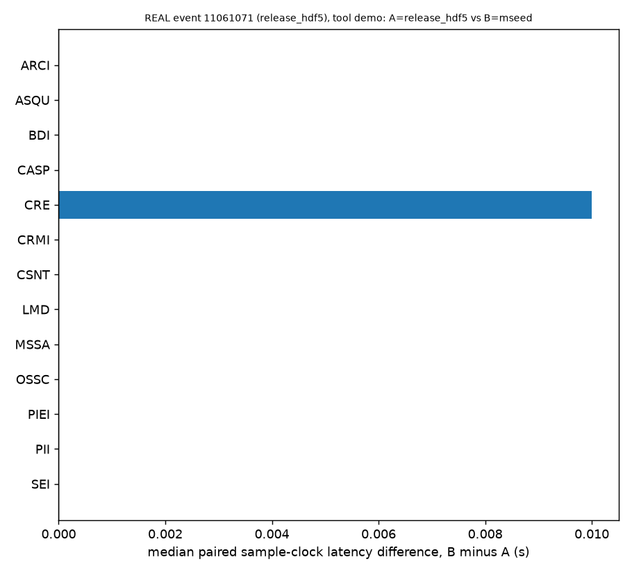

# Real recorded event demo (tool demonstration, 3 events)

Research testbed, not an operational warning system. **These are tool demonstrations on 3 recorded events, not
performance evidence.** One generic detector configuration was used (not tuned on any outcome), 3 events were
replayed, and the reference is a reviewed catalog pick with a stated uncertainty. Nothing here supports a claim about
detector performance, the INSTANCE release product, or early warning. No waveform data are committed.

Data: INSTANCE v3 sample (INGV), DOI 10.13127/instance, CC BY 4.0 per the INGV INSTANCE page; network IV (DOI
10.13127/sd/x0fxnh7qfy per the INGV FDSN station service, read 2026-10-26). Two input kinds were used for every
event:

- **`release_hdf5`**: the INSTANCE release product (full-window processed counts). Labeled everywhere as "INSTANCE
  release product, full-window processed, NOT causal input".
- **`mseed`**: the original INGV miniSEED from the FDSN dataselect service, cut at the nearest raw sample to the
  metadata start time, no shifting; processed only by the causal streaming chain.

## Events

Development events come from IV/HH/Z/100 Hz sample traces whose event id has **no trace in the frozen Stage 1 draw**
(`docs/cohort_stage1_traces.txt`, sha256 `2f32530f...`); the paused pre-registered study is not contaminated. Pool: 183
traces in 40 events. Only 2 events have at least 8 stations (11061071 with 16 and 11152091 with 12), so the rule was
relaxed for the third slot: a seeded choice (seed 20261110) among the 5 events with 7 stations gave 11151081. The choice
was made from metadata only; see `docs/dev_events.txt` and `scripts/select_dev_events.py`.

| event | stations in HDF5 arm | stations in miniSEED arm | stations excluded in the miniSEED arm |
|---|---|---|---|
| 11061071 | 16 | 13 | FROS, MCIV, TRIF (INGV returned no data) |
| 11152091 | 12 | 8 | T1243, T1245, T1247, T1256 (no data) |
| 11151081 | 7 | 4 | T1243, T1245, T1256 (no data) |

## What was run

```bash
python scripts/select_dev_events.py --out docs/dev_events.txt
python scripts/fetch_dev_events.py --sleep 1.0            # 35 traces: 25 returned data, 10 empty responses
for ev in 11061071 11152091 11151081; do for inp in release_hdf5 mseed; do
  quakenode sweep examples/instance_event/sweep.yaml --set scenario.instance.event_id=$ev \
      --set scenario.instance.input=$inp --out-dir runs/dev_demo
done; done
# matched-station comparison of the two inputs (same stations in both arms, no faults):
quakenode run examples/instance_event/config_mseed.yaml --set scenario.instance.event_id=$ev \
    --set scenario.instance.input=$inp --set 'scenario.instance.stations=[...stations present in the miniSEED arm...]' \
    --set faults.0.p=0 --out-dir runs/matched
```

Settings (from `examples/instance_event/sweep.yaml`): detector `recursive_sta_lta` (STA 0.5 s, LTA 4 s, thresholds on
3.0 / off 1.5, one-pole baseline removal at 0.5 Hz), 1 s packets (100 samples), fusion 3-of-n on the emission clock
(window 10 s, update window 5 s), hit window [catalog P - 1 s, catalog P + 10 s], 5 seeds (only the fault randomness
changes; the data are fixed), Bernoulli packet loss `p` in {0, 0.02, 0.05, 0.1} crossed with the three gap policies
(`reset`, `hold`, `zero_fill`), every point paired with a matched no-fault control. Python 3.11.17. Each sweep took
about 9 s.

Event reference definitions: per-station latency = trigger sample time minus the catalog P time (sample clock);
emission latency = emission time minus the catalog P time; event association latency = creation time (emission clock)
of the first candidate with at least 3 contributing hits minus the **earliest** catalog P time of the event. The stated
P uncertainty (0.1 to 0.6 s in these events) is printed next to every station in the reports.

## What the runs showed (plain words, with caveats)

1. **The tool replays a recorded event end to end.** Packets from 4 to 16 stations on one clock, faults, detector,
   fusion and metrics ran for all six event/input combinations and wrote labeled reports, event logs and manifests.

2. **Release product versus raw miniSEED, same stations, no faults: nearly identical trigger times.** With the same
   stations in both arms, the per-station detection latency differed by at most 0.03 s, and the event association
   latency was identical:

   | event | stations compared | stations with identical latency | stations that differ (miniSEED minus HDF5) | association latency (HDF5 / miniSEED) |
   |---|---|---|---|---|
   | 11061071 | 13 | 12 | CRE +0.01 s | 1.20 s / 1.20 s |
   | 11152091 | 8 | 7 | GIGS +0.02 s | 0.47 s / 0.47 s |
   | 11151081 | 4 | 2 | LNSS +0.03 s; TERO undetected in both | 8.81 s / 8.81 s |

   This is a description of 3 events and one detector that removes its own baseline; it is not evidence about the
   release processing in general. In the first comparison (all stations in each arm) the association latencies differ
   (event 11061071: 0.78 s with HDF5 and 1.20 s with miniSEED) only because the miniSEED arm lacks three stations;
   comparing inputs needs the same stations in both arms.

3. **Packet loss under the three gap policies (detection fraction, median over 5 seeds; 1.0 = every station
   detected).** The same pattern as the SYNTHETIC example: `reset` loses detections as loss grows (the detector goes
   blind after each gap for the length of its LTA window), `hold` loses little, and `zero_fill` depends on the data:

   | event, input (stations) | gap policy | p = 0 | 0.02 | 0.05 | 0.1 |
   |---|---|---|---|---|---|
   | 11061071 HDF5 (16) | reset / hold / zero_fill | 1.00 / 1.00 / 1.00 | 0.94 / 1.00 / 1.00 | 0.88 / 1.00 / 1.00 | 0.75 / 0.94 / 1.00 |
   | 11061071 miniSEED (13) | reset / hold / zero_fill | 1.00 / 1.00 / 1.00 | 0.92 / 1.00 / 0.92 | 0.92 / 1.00 / 0.77 | 0.69 / 0.92 / 0.69 |
   | 11152091 HDF5 (12) | reset / hold / zero_fill | 1.00 / 1.00 / 1.00 | 0.92 / 1.00 / 1.00 | 0.92 / 1.00 / 1.00 | 0.75 / 1.00 / 1.00 |
   | 11152091 miniSEED (8) | reset / hold / zero_fill | 1.00 / 1.00 / 1.00 | 1.00 / 1.00 / 0.75 | 1.00 / 1.00 / 0.50 | 0.75 / 1.00 / 0.50 |
   | 11151081 HDF5 (7) | reset / hold / zero_fill | 0.71 / 0.71 / 0.71 | 0.57 / 0.71 / 0.71 | 0.57 / 0.71 / 0.71 | 0.43 / 0.71 / 0.71 |
   | 11151081 miniSEED (4) | reset / hold / zero_fill | 0.75 / 0.75 / 0.75 | 0.50 / 0.75 / 0.50 | 0.50 / 0.75 / 0.25 | 0.50 / 0.75 / 0.25 |

   `zero_fill` is harmless on the release product (zero-mean, detrended data) and harmful on raw counts, where
   inserted zeros are a step against the instrument baseline and trigger the detector (see `docs/gap_policies.md`).
   With few stations and 5 seeds these numbers are coarse; the paired differences and event-level detection rates are
   in each sweep's `sweep_table.md`.

4. **Some stations are slow or silent for this detector.** For example event 11152091 station FDMO triggered 8.1 s after
   the catalog P, and station TERO of event 11151081 did not trigger in either input. Event 11151081 has a median
   detection latency of several seconds with a detection fraction of 0.71 (HDF5) or 0.75 (miniSEED) even without
   faults. This says something about this untuned generic detector on these traces, nothing more; no outcome was used
   to choose or change any setting. The reports also show many pre-event triggers per station (the re-arming detector
   fires on noise), counted as false triggers against the catalog P.

## Plots

`docs/img/real_event_11061071_release_hdf5_gap_policy_sweep.png` and
`docs/img/real_event_11061071_mseed_gap_policy_sweep.png` show the sweep for event 11061071 with each input. Left: station
detection fraction versus packet-loss probability for the three gap policies (dashed = matched no-fault control).
Middle: median emission latency (detected stations only; conditional on detection). Right: fraction of seeds in which
the 3-of-n event candidate was created from true hits. Plot titles carry the event, the input kind and "tool demo".




## Input-kind comparison with `quakenode compare` (event 11061071)

```bash
quakenode compare examples/instance_event/config_hdf5.yaml \
    --a scenario.instance.input=release_hdf5 --b scenario.instance.input=mseed \
    --set 'faults=[]' --set 'seeds=[1]'
```

Arm A = INSTANCE release product (`release_hdf5`, full-window processed, **NOT causal input**); arm B = raw INGV
miniSEED processed only by the causal chain. No faults, one seed (the data are fixed, so extra seeds would repeat the
same numbers). The miniSEED arm lacks FROS, MCIV and TRIF (INGV returned no data), so `compare` re-ran both arms on the
13 common stations and listed those three as dropped. Differences are B minus A; latency is the sample-clock trigger
time minus the catalog P time; "P unc" is the stated uncertainty of the catalog pick.

| station | P unc (s) | latency A, HDF5 (s) | latency B, miniSEED (s) | diff B-A (s) |
|---|---|---|---|---|
| ARCI | 0.30 | 0.630 | 0.630 | +0.000 |
| ASQU | 0.30 | 0.300 | 0.300 | +0.000 |
| BDI | 0.60 | 0.250 | 0.250 | +0.000 |
| CASP | 0.30 | 0.440 | 0.440 | +0.000 |
| CRE | 0.30 | 0.430 | 0.440 | +0.010 |
| CRMI | 0.10 | 0.040 | 0.040 | +0.000 |
| CSNT | 0.10 | 0.050 | 0.050 | +0.000 |
| LMD | 0.30 | 0.380 | 0.380 | +0.000 |
| MSSA | 0.60 | 0.020 | 0.020 | +0.000 |
| OSSC | 0.10 | 0.030 | 0.030 | +0.000 |
| PIEI | 0.60 | 2.020 | 2.020 | +0.000 |
| PII | 0.10 | 0.020 | 0.020 | +0.000 |
| SEI | 0.30 | 0.260 | 0.260 | +0.000 |

Detection status over the 13 (station, seed) pairs: detected in both 13, only A 0, only B 0, neither 0. Paired sample-clock
difference: median +0.000 s, quartiles [+0.000, +0.000] (12 of 13 stations identical, CRE +0.010 s). Event association
latency (emission clock, relative to the earliest catalog P): 1.200 s in both arms.

Caveats: one event, one detector configuration (which removes its own baseline), 13 stations, no faults; the catalog P
picks carry the stated uncertainties above, which are far larger than the differences shown for most stations. This
describes what happened in this demonstration; it is not evidence about the release processing in general, detector
performance, or warning time. Plot: `img/real_event_11061071_compare_hdf5_vs_mseed.png`.



## Limits

3 events (one chosen with a relaxed rule), 1 detector configuration, 5 seeds, IV/HH/Z only, catalog P with stated
uncertainty as reference, stations without raw data dropped from the miniSEED arm, no ground motion or warning time.
The runs are tool demonstrations: they exercise input kinds, labeling, timelines and fault handling on recorded data.
